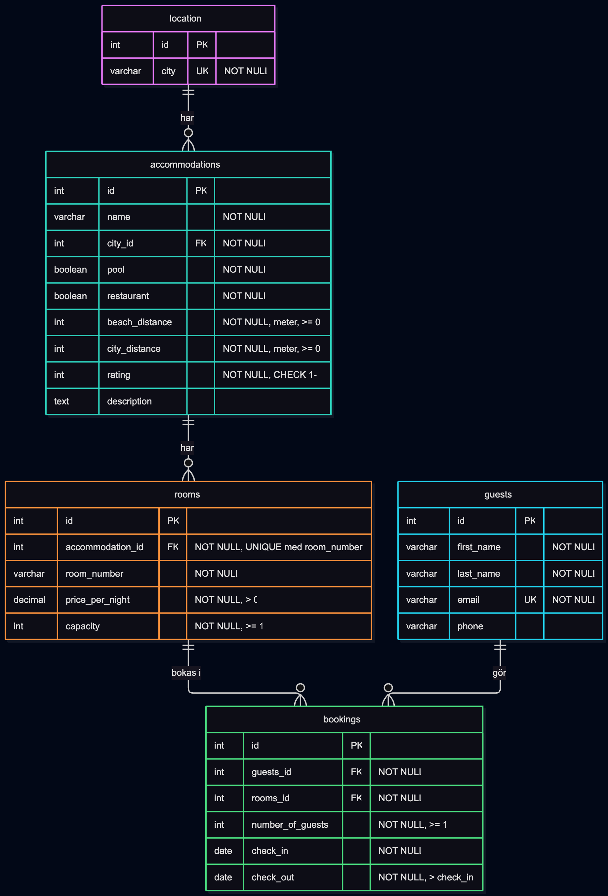
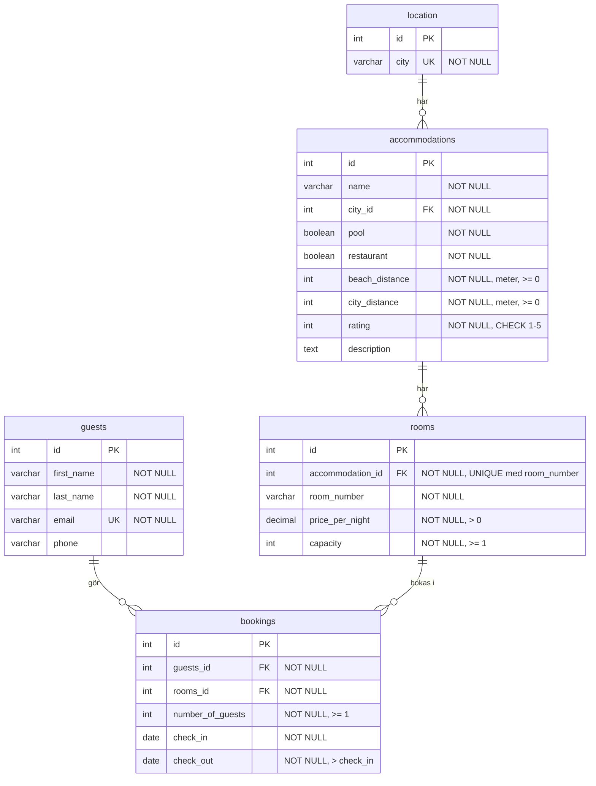

# Holiday Maker

En konsolapplikation i C# där en resebyråoperatör kan registrera kunder, söka lediga rum, boka, visa, ändra och avboka. Data lagras i en MySQL-databas. All sökning, filtrering och sortering görs i SQL med parameteriserade frågor. Dvs frågan och användarens inmatning hålls isär, så inmatningen kan aldrig köras som kod.

## Krav

- **MySQL 8** (utvecklat och testat med MySQL 8.4 i Docker)
- **.NET SDK 10**
- En databasklient, t.ex. Sequel Ace, MySQL Workbench eller DBeaver

NuGet-paketet `MySqlConnector` (2.6.2) hämtas automatiskt vid första bygget.

## 1. Skapa databasen

Öppna `holidaymaker.sql` i en databasklient och kör **hela** skriptet.

Skriptet:
- tar bort en eventuell tidigare databas `holidaymaker` och skapar den på nytt
- skapar tabellerna med primärnycklar, främmande nycklar, `UNIQUE` och `CHECK`
- lägger in testdata: 5 orter, 7 boenden, 26 rum, 5 kunder och 26 bokningar i december 2026
- kör några exempelfrågor som visar sökningen av lediga rum

Från terminalen går det också:

```bash
mysql -u root -p < holidaymaker.sql
```

## 2. Anslutning

Programmet ansluter till `127.0.0.1:3306`, databasen `holidaymaker` och användaren `root`. Om din MySQL använder en annan server, port eller användare ändrar du connection stringen i `Database.cs`.

Lösenordet ligger **inte** i källkoden. Programmet läser det från miljövariabeln `HOLIDAYMAKER_DB_PASSWORD`.

## 3. Kör programmet

Stå i projektmappen (där `HolidayMaker.csproj` finns).

**macOS / Linux:**

```bash
HOLIDAYMAKER_DB_PASSWORD=ditt_lösenord dotnet run
```

**Windows (PowerShell):**

```powershell
$env:HOLIDAYMAKER_DB_PASSWORD="ditt_lösenord"
dotnet run
```

## Använda programmet

```
===Holiday Maker===
1. Registrera kund
2. Välj kund
3. Sök lediga rum och boka
4. Visa kundens bokningar
5. Ändra antal personer
6. Avboka
0. Avsluta
```

Ett typiskt flöde är **2 → 3 → 4 → 6**: välj kund, sök och boka rum, visa bokningen och avboka.

- En kund väljs med menyval 2. En nyregistrerad kund (menyval 1) måste också väljas med menyval 2 innan den kan boka.
- Menyval 4–6 kräver en vald kund. I menyval 3 går det att söka utan vald kund, men för att boka måste en kund vara vald.
- Vid sökning anges ort, in- och utcheckningsdatum (`ÅÅÅÅ-MM-DD`) och antal personer. Därefter kan man välja filter (pool, restaurang, max avstånd till strand och centrum) och sortering (pris lägst först eller omdöme högst först). Tryck Enter för att hoppa över ett avståndsfilter.
- Mallorca har tre boenden med olika omdöme och faciliteter och passar bäst för att prova filter och sortering.

## Projektstruktur

| Fil | Ansvar |
|---|---|
| `holidaymaker.sql` | Skapar databasen, tabeller, begränsningar och testdata |
| `Program.cs` | Menyn och huvudloopen |
| `Database.cs` | Connection string och öppning av anslutning |
| `Input.cs` | Säker inmatning (heltal, text, datum, j/n), så att felaktig inmatning inte kraschar programmet |
| `GuestService.cs` | Registrera och välja kund |
| `RoomService.cs` | Sök lediga rum med filter och sortering |
| `BookingService.cs` | Skapa, visa, ändra och avboka bokningar |

## Databasen i korthet

| Tabell | Innehåll | Relationer |
|---|---|---|
| `location` | Orter | |
| `accommodations` | Boenden: namn, pool, restaurang, avstånd (meter), omdöme 1–5 | `city_id` → `location` |
| `rooms` | Rum: rumsnummer, kapacitet, pris per natt | `accommodation_id` → `accommodations` |
| `guests` | Kunder: namn, e-post (unik), telefon | |
| `bookings` | En kund + ett rum + datum + antal personer | `guests_id` → `guests`, `rooms_id` → `rooms` |

Ett rum är ledigt om ingen bokning för rummet uppfyller `check_in < önskad utcheckning AND check_out > önskad incheckning`. Utcheckningsdagen upptar alltså inte rummet. Totalpriset lagras inte utan räknas ut som antal nätter × pris per natt.

Regler som gäller flera rader eller tabeller (att sällskapet ryms i rummet och att bokningar inte överlappar) kan inte uttryckas med `CHECK`. De kontrolleras i applikationen, och tillgängligheten kontrolleras en gång till precis innan en bokning sparas.

## E/R-diagram



`PK` = primärnyckel, `FK` = främmande nyckel, `UK` = unik. `||--o{` betyder en till noll eller många.



## Testdokumentation

Manuella tester mot testdatan i `holidaymaker.sql`. Bokningsnummer och "Hytt 1", "Bokning 16" osv. avser testdatan som den ser ut direkt efter att skriptet körts.

Testerna ändrar i databasen (t.ex. bokar Test 2 och Test 7 samma rum). Avboka testbokningar efter varje test, eller kör `holidaymaker.sql` igen för att återställa testdatan.

### Test 1: Ett ledigt rum visas och ett upptaget filtreras bort
| | |
|---|---|
| **Steg** | Välj kund → 3 → Malé, 2026-12-03 – 2026-12-07, 2 personer, inga filter, sortering 1 |
| **Förväntat** | Hytt 3 och Hytt 4 visas. Hytt 1 (bokning 1, 1–5 dec) och Hytt 2 (bokning 4, 3–8 dec) visas inte. |
| **Resultat** | OK – Hytt 3 och Hytt 4 visades. Hytt 1 och Hytt 2 visades inte. |

### Test 2: Bokning samma dag som en tidigare kund checkar ut
| | |
|---|---|
| **Steg** | Sök Malé, 2026-12-10 – 2026-12-13, 2 personer → boka Hytt 1 |
| **Förväntat** | Hytt 1 visas, trots att bokning 2 checkar ut 10/12. Bokningen går igenom med totalpris 3 × 500 = 1500 kr. |
| **Resultat** | OK – Hytt 1 visades och bokades, bokningsnr 27, totalpris 1500 kr. |

### Test 3: Överlappande bokningar nekas, även omslutande
Hytt 3 (6 personer) är bokad 10–17 dec (bokning 5). Sökningar i Malé med 6 personer, så att bara Hytt 3 är aktuell:

| Sökning | Typ | Förväntat | Resultat |
|---|---|---|---|
| 12–14 dec | ligger inuti | Inga lediga rum | OK – "Inga lediga rum matchar sökningen" |
| 08–20 dec | omsluter bokningen | Inga lediga rum | OK – "Inga lediga rum matchar sökningen" |
| 08–12 dec | överlappar början | Inga lediga rum | OK – "Inga lediga rum matchar sökningen" |
| 17–20 dec | börjar på utcheckningsdagen | Hytt 3 visas | OK – Hytt 3 visades (6 personer, 2000 kr/natt) |

**Kontroll vid sparande** (tillgängligheten kontrolleras igen när bokningen sparas):

| | |
|---|---|
| **Steg** | Välj kund → sök Malé 17–20 dec, 6 personer → Hytt 3 (RumId 3) visas. **Innan** RumId anges: lägg in en bokning på rum 3 för 18–19 dec direkt i databasklienten. Ange sedan RumId 3. |
| **Förväntat** | "Rummet är tyvärr redan bokat under den perioden." |
| **Resultat** | OK – Hytt 3 visades i sökningen. En överlappande bokning (18–19 dec) lades in i Sequel Ace innan RumId angavs. När RumId 3 angavs svarade programmet "Rummet är tyvärr redan bokat under den perioden" och ingen bokning sparades. |

```
Ange RumId att boka (0 = avbryt): 3
Rummet är tyvärr redan bokat under den perioden.
```

### Test 4: För stort sällskap kan inte boka
| | |
|---|---|
| **Steg** | Sök Malé, 2026-12-17 – 2026-12-20, 7 personer |
| **Förväntat** | "Inga lediga rum matchar sökningen", eftersom största rummet i Malé tar 6 personer |
| **Resultat** | OK – "Inga lediga rum matchar sökningen". Största rummet i Malé (Hytt 3) har plats för 6. |

### Test 5: Kombinerade filter och båda sorteringarna
Alla sökningar: Mallorca, 2026-12-10 – 2026-12-13, 2 personer.

| Filter / sortering | Förväntat | Resultat |
|---|---|---|
| Inga filter, sortering pris | Suite A (150 kr) först, Suite C (1500 kr) sist | OK – 8 rum, Suite A 150 kr först, Suite C 1500 kr sist |
| Inga filter, sortering omdöme | Casa Vieja (5) först, sedan Playa Sol (4), sist Gecko Hotel (3) | OK – Casa Vieja (5) först, sedan Playa Sol (4), sist Gecko Hotel (3) |
| Pool + restaurang | Bara Gecko Hotel | OK – bara Gecko Hotel (3 rum) |
| Restaurang + max 500 m till strand | Bara Playa Sol | OK – bara Playa Sol (2 rum) |
| Pool + max 500 m till centrum | Bara Casa Vieja | OK – bara Casa Vieja (3 rum) |
| Pool + restaurang + max 500 m till strand | Inga lediga rum | OK – "Inga lediga rum matchar sökningen" |

### Test 6: Ändring av antal personer följer rummets kapacitet
| | |
|---|---|
| **Steg** | Välj Sara Gonzales (id 1) → 5 → bokning 16 (Rum 312, plats för 2) → först 3 personer, sedan 1 person |
| **Förväntat** | 3 nekas ("Rummet har bara plats för 2 personer"). 1 godkänns och syns i menyval 4. |
| **Resultat** | OK – 3 personer nekades med "Rummet har bara plats för 2 personer". 1 person godkändes och syns i menyval 4. |

### Test 7: Avbokning frigör rummet
| | |
|---|---|
| **Steg** | Sök Malé 10–13 dec, 2 personer → boka Hytt 1 → sök igen → avboka (6) → sök igen |
| **Förväntat** | Hytt 1 visas, försvinner efter bokningen och kommer tillbaka efter avbokningen |
| **Resultat** | OK – Hytt 1 visades och bokades (bokningsnr 28). Vid ny sökning saknades Hytt 1. Efter avbokning av bokning 28 visades Hytt 1 igen. |

### Test 8: Uppgifterna finns kvar efter omstart
| | |
|---|---|
| **Steg** | Registrera ny kund (1) → välj kunden (2) → sök och boka ett rum (3) → avsluta (0) → starta programmet igen → välj kunden (2) → visa bokningar (4) |
| **Förväntat** | Kunden och bokningen finns kvar |
| **Resultat** | OK – Kunden Test Testsson (id 6) och bokning 29 (Casa Vieja, Suite A, 10–13 dec, 450 kr) fanns kvar efter omstart. |

### Test 9: Felaktig inmatning avslutar inte programmet
| Inmatning | Förväntat | Resultat |
|---|---|---|
| Menyval `abc`, tomt, `9` | "Ogiltigt val", menyn visas igen | OK – "Ogiltigt val, försök igen." visades för alla tre och menyn kom tillbaka |
| Datum `10/12` | "Skriv datumet som ÅÅÅÅ-MM-DD" | OK – "Skriv datumet som ÅÅÅÅ-MM-DD, t.ex. 2026-12-10." och frågan ställdes igen |
| Utcheckning före incheckning | "Utcheckning måste vara efter incheckning" | OK – "Utcheckning måste vara efter incheckning." och tillbaka till menyn |
| Antal personer `0` | "Antal personer måste vara minst 1" | OK – "Antal personer måste vara minst 1." och tillbaka till menyn |
| E-post som redan finns | "Det finns redan en kund med den e-postadressen" | Först FEL – dubblerad e-post gav ett tekniskt databasfel. Lade till felhantering i `GuestService.Register()`, testade igen: OK. |
| Boka utan vald kund | "Välj en kund (menyval 2) för att kunna boka" | OK – sökresultatet visades, följt av "Välj en kund (menyval 2) för att kunna boka." |
